# Olá, sou o Renan 👋

## Minha Empresa

<a href="https://usecodelabs.com/">
  <picture>
    <source media="(prefers-color-scheme: dark)" srcset="./assets/codelabs-dark.svg">
    <source media="(prefers-color-scheme: light)" srcset="./assets/codelabs-light.svg">
    
  </picture>
</a>

## Stacks

## Discord

